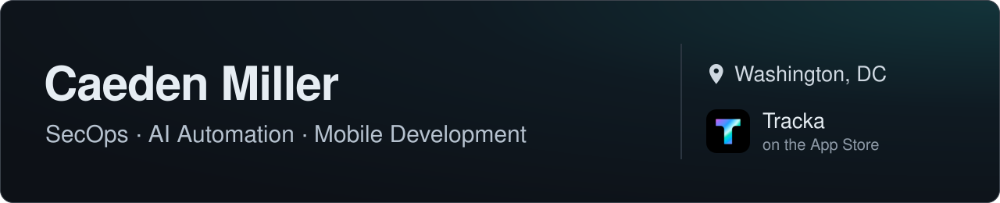

- Building **[Tracka](https://gettracka.com)**: an iOS app for collection tracking and card-show discovery, with live market pricing across a 40,000-card catalog, a paid subscription tier and over 700 active users.
- **Security automation** for a Top 100 US bank, focused on SOAR playbook development, Tier 1 to 3 incident response and automation validation.

### Skills

[LinkedIn](https://www.linkedin.com/in/caedenmiller)
